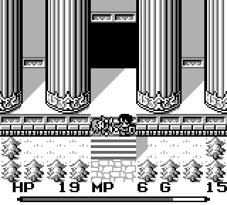
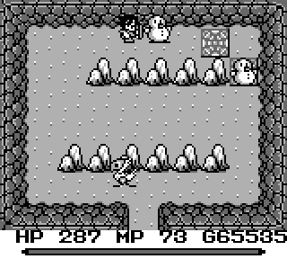
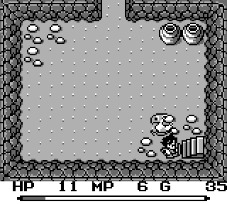
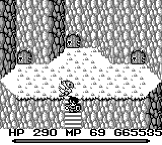

[*Back home*](index)

# The Glitches

This section documents every glitch fixed in the [RAI Project](rai).

## Trigger Tile Bugs
A trigger tile is a visible or invisible metatile (16x16 px block) that either
causes damage from spikes/lava, or more importantly executes internal scripts
like 'load a new room' or 'reveal a staircase'. There are multiple ways trigger
tiles can be skipped, which leads to warps, or puzzles that have to be reloaded.

<fieldset markdown="1" style="border: 1px solid #cccccc; border-radius: 6px; padding: 15px; background: transparent; margin-bottom: 20px;">
<legend style="padding: 0 8px; font-weight: bold; font-size: 1.25em; color: #cccccc;">Trigger Tile Misses from 8 Pixel Snapping</legend>

#### Synopsis

Because the game operates on an 8 pixel grid, sometimes the game will call a
function to snap an 'object' (a player, an enemy, an NPC, or even snowmen and
chests) back on to the grid. This happens for players when they return from
invincibility frames to a normal condition (i.e., a few seconds after being
injured). This happens for other objects like NPCs when their current action
(e.g., move up, move left, shimmy in place) ends. Ironically, even
Ice-magic-induced snowmen and empty chests have actions. These actions do
nothing, but they still do the nothing action and then snap to the nearest 8
pixel boundary. This is why pushing snowmen/chests often looks jittery -
they're snapping to a boundary every couple seconds. Unfortunately, the
function that snaps an object back on grid also skips checking if they were
snapped to a trigger tile.

#### Origin

This was the first glitch I encountered as a 7 year-old in 1992. While chasing
down 'Man' in Wendel, I got hit by a rabite and was knocked back to the
previous screen.  While having invincibility frames, I tried going back south
into Wendel, but instead wound up warping to the Mana Shrine because I missed
the trigger tile. This glitch is also the reason for one of the most common
annoyances in FFA: puzzle room failures.  The speedrun community has plenty of
horror stories of completing a snowman puzzle room only for the staircase to
not appear. It's not *always* this bug's fault, but it *usually* is.

#### RAI Status

Issue: [Trigger Tile Misses from 8px Snapping](https://github.com/dagmorland/FFA-Musings/issues/31) 
Release Version: TBD

#### Possible Exploits

There are not many places the player can use this to their advantage. The
Wendel to Mana Shrine warp is not positioned to allow the player to continue in
the Mana Shrine... it's a dead end. I'm sure there are other potential places
to exploit this, but given the difficulty to pull this off, and requiring to
get hurt beforehand, they aren't currently being used in the speedrunning
community. As for snowmen/chests not triggering puzzle tiles, that's just
annoying, not exploitable.

#### Example

Warping from Wendel to the Mana Shrine. 

Completing a puzzle that doesn't work like it should. 

</fieldset>

<fieldset markdown="1" style="border: 1px solid #cccccc; border-radius: 6px; padding: 15px; background: transparent; margin-bottom: 20px;">
<legend style="padding: 0 8px; font-weight: bold; font-size: 1.25em; color: #cccccc;">Simultaneous Script Triggers Skip the Player</legend>

#### Synopsis

The
game checks when an object enters or leaves a trigger tile's space,
governed by the 8-pixel layout mechanics. On any given frame, multiple objects (the player, NPCs, enemies, followers, etc.)
may interact with one or multiple trigger tiles across the current map. 
As the game is checking the list of objects for these interactions, if
any does in fact trigger a script, then it sets that script in motion and
ignores any other triggers on the same frame. Unfortunately, the player's tile
interactions are typically checked last. Also unfortunately, the script itself
checks whether a triggering object is important to the script, exiting early in
most cases. That means if another NPC (a follower
or an enemy) triggers a script at the same time as the player, the player's
trigger script is ignored.

#### Origin

I think just about everyone that's played this game has had a staircase
not fire when walking on it near a follower. It's not too disruptive, so
I expect most people shrugged it off. I discovered how the glitch could be
used for warping while testing speedrunning route ideas in March, 2023.
In my case, I was walking south with a follower from the three door room in the Undersea
Volcano when I surprisingly walked past the trigger tile and to the Mana Road.

#### RAI Status

Issue: [Simultaneous Script Triggers Skip the Player](https://github.com/dagmorland/FFA-Musings/issues/34) 
Release Version: TBD

#### Possible Exploits

This trick was a big part of my [first world record run](https://youtu.be/fT9ewtd9kao).
Before this, speed runners would have to use a snowman combined with a follower to sneak
past (using a different glitch). As such, [Glasgow_Gavin](https://www.speedrun.com/users/Glasgow_Gavin)
coined this the 'snowmanless' glitch, and it's stuck ever since.
This trick can be used in several similar situations: warping from the Undersea
Volcano to the Mana Road, from Ish to Glaive Castle, and from Jadd to Wendel.
I'm sure there are others to find as well. Note that a follower isn't strictly required.
As long as an enemy that isn't flying steps on a tile with a script trigger, the glitch
will work.

#### Example

Follower blocking a staircase script trigger. 

Warping from Undersea Volcano to the Mana Road/Shrine. 

</fieldset>

