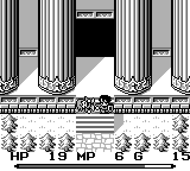
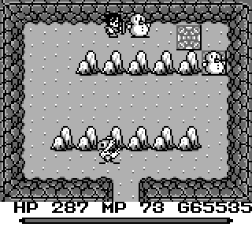
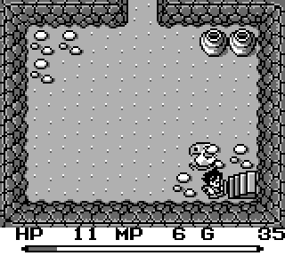
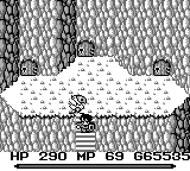
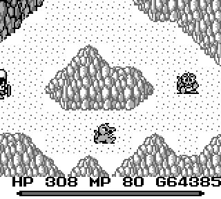
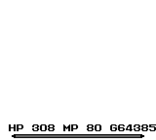
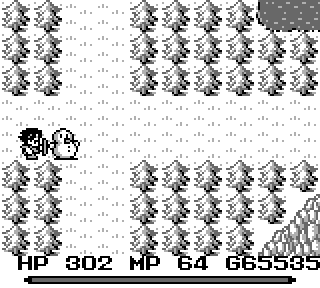
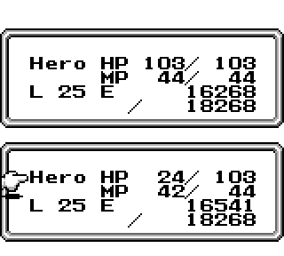

[*Back home*](index)

# The Glitches

This section documents every glitch fixed in the [RAI Project](rai).

## Trigger Tile Bugs
A trigger tile is a visible or invisible metatile (16x16 px block) that either
causes damage from spikes/lava, or more importantly executes internal scripts
like 'load a new room' or 'reveal a staircase'. There are multiple ways trigger
tiles can be skipped, which leads to warps, or puzzles that have to be reloaded.

<fieldset markdown="1" style="border: 1px solid #cccccc; border-radius: 6px; padding: 15px; background: transparent; margin-bottom: 20px;">
<legend style="padding: 0 8px; font-weight: bold; font-size: 1.25em; color: #cccccc;">Trigger Tile Misses from 8 Pixel Snapping</legend>

#### Synopsis

Because the game operates on an 8 pixel grid, sometimes the game will call a
function to snap an 'object' (a player, an enemy, an NPC, or even snowmen and
chests) back on to the grid. This happens for players when they return from
invincibility frames to a normal condition (i.e., a few seconds after being
injured). This happens for other objects like NPCs when their current action
(e.g., move up, move left, shimmy in place) ends. Ironically, even
Ice-magic-induced snowmen and empty chests have actions. These actions do
nothing, but they still do the nothing action and then snap to the nearest 8
pixel boundary. This is why pushing snowmen/chests often looks jittery -
they're snapping to a boundary every couple seconds. Unfortunately, the
function that snaps an object back on grid also skips checking if they were
snapped to a trigger tile.

#### Origin

This was the first glitch I encountered as a 7 year-old in 1992. While chasing
down 'Man' in Wendel, I got hit by a rabite and was knocked back to the
previous screen.  While having invincibility frames, I tried going back south
into Wendel, but instead wound up warping to the Mana Shrine because I missed
the trigger tile. This glitch is also the reason for one of the most common
annoyances in FFA: puzzle room failures.  The speedrun community has plenty of
horror stories of completing a snowman puzzle room only for the staircase to
not appear. It's not *always* this bug's fault, but it *usually* is.

#### RAI Status

Issue: [Trigger Tile Misses from 8px Snapping](https://github.com/dagmorland/FFA-Musings/issues/31) 
Release Version: TBD

#### Possible Exploits

There are not many places the player can use this to their advantage. The
Wendel to Mana Shrine warp is not positioned to allow the player to continue in
the Mana Shrine... it's a dead end. I'm sure there are other potential places
to exploit this, but given the difficulty to pull this off, and requiring to
get hurt beforehand, they aren't currently being used in the speedrunning
community. As for snowmen/chests not triggering puzzle tiles, that's just
annoying, not exploitable.

#### Example

Warping from Wendel to the Mana Shrine. 

Completing a puzzle that doesn't work like it should. 

</fieldset>

<fieldset markdown="1" style="border: 1px solid #cccccc; border-radius: 6px; padding: 15px; background: transparent; margin-bottom: 20px;">
<legend style="padding: 0 8px; font-weight: bold; font-size: 1.25em; color: #cccccc;">Simultaneous Script Triggers Skip the Player</legend>

#### Synopsis

The game checks when an object enters or leaves a trigger tile's space,
governed by the 8-pixel layout mechanics. On any given frame, multiple objects
(the player, NPCs, enemies, followers, etc.) may interact with one or multiple
trigger tiles across the current map.  As the game is checking the list of
objects for these interactions, if any does in fact trigger a script, then it
sets that script in motion and ignores any other triggers on the same frame.
Unfortunately, the player's tile interactions are typically checked last. Also
unfortunately, the script itself checks whether a triggering object is
important to the script, exiting early in most cases. That means if another NPC
(a follower or an enemy) triggers a script at the same time as the player, the
player's trigger script is ignored.

#### Origin

I think just about everyone that's played this game has had a staircase not
fire when walking on it near a follower. It's not too disruptive, so I expect
most people shrugged it off. I discovered how the glitch could be used for
warping while testing speedrunning route ideas in March, 2023.  In my case, I
was walking south with a follower from the three door room in the Undersea
Volcano when I surprisingly walked past the trigger tile and to the Mana Road.

#### RAI Status

Issue: [Simultaneous Script Triggers Skip the Player](https://github.com/dagmorland/FFA-Musings/issues/34) 
Release Version: TBD

#### Possible Exploits

This trick was a big part of my [first world record
run](https://www.speedrun.com/ffa/runs/yonkkndz).  Before this, speed runners
would have to use a snowman combined with a follower to sneak past (using a
different glitch). As such,
[Glasgow_Gavin](https://www.speedrun.com/users/Glasgow_Gavin) coined this the
'snowmanless' glitch, and it's stuck ever since.  This trick can be used in
several similar situations: warping from the Undersea Volcano to the Mana Road,
from Ish to Glaive Castle, and from Jadd to Wendel.  I'm sure there are others
to find as well. Note that a follower isn't strictly required.  As long as an
enemy that isn't flying steps on a tile with a script trigger, the glitch will
work.

#### Example

Follower blocking a staircase script trigger. 

Warping from Undersea Volcano to the Mana Road/Shrine. 

</fieldset>

<fieldset markdown="1" style="border: 1px solid #cccccc; border-radius: 6px; padding: 15px; background: transparent; margin-bottom: 20px;">
<legend style="padding: 0 8px; font-weight: bold; font-size: 1.25em; color: #cccccc;">Spear Butt Keeps Flying Through Walls</legend>

#### Synopsis

If you throw a spear (max will) at a wall or mountain, the tip breaks off but
the butt keeps flying throw the end of the screen. This is a graphics-only issue
for FFA, but it does mess with some ROM hacks.

#### Origin

If you've played the game, I bet you've seen this, too.

#### RAI Status

Issue: [Spear Butt Keeps Flying Through Walls](https://github.com/dagmorland/FFA-Musings/issues/36) 
Release Version: TBD

#### Possible Exploits

None that I know of, but the spear butt was causing object interaction issues
for Embers of Mana.

#### Example

Spear butt keeps flying through a mountain. 

</fieldset>

<fieldset markdown="1" style="border: 1px solid #cccccc; border-radius: 6px; padding: 15px; background: transparent; margin-bottom: 20px;">
<legend style="padding: 0 8px; font-weight: bold; font-size: 1.25em; color: #cccccc;">Wall in Glaive Castle has Unexpected Movement Restriction</legend>

#### Synopsis

There is a room in Glaive Castle where a northern jut out wall does not allow
the player to approach it. Originally, I thought it was a glitch with the
collision flags, but the way the game is set up does not allow for a half-height
wall like this. As such, the fix is to extend the graphics to match the reality
of the existing movement pattern.

#### Origin

Found while working on [LotMS](https://xenophile127.github.io/Legend-of-the-Mana-Sword/).

#### RAI Status

Issue: [Wall in Glaive Castle has Unexpected Movement Restriction](https://github.com/dagmorland/FFA-Musings/issues/38) 
Release Version: TBD

#### Possible Exploits

Just a graphics glitch, no exploits.

#### Example

Before the fix 

After the fix 

</fieldset>

<fieldset markdown="1" style="border: 1px solid #cccccc; border-radius: 6px; padding: 15px; background: transparent; margin-bottom: 20px;">
<legend style="padding: 0 8px; font-weight: bold; font-size: 1.25em; color: #cccccc;">Snowmen/Chests Twitch while being Pushed</legend>

#### Synopsis

Snowmen (created through the Ice spell) and empty chests are NPCs just like
any other enemy. That means these seemingly motionless objects are really
performing behavior patterns and actions just like any other NPC. When an action
end for an NPC, it snaps to the nearest 8 pixel gridded tile. For these special
objects, that looks quite strange when they're being pushed around to solve
puzzles. This is fixed by delaying the 'do nothing' action on these objects
while they are being pushed, creating smooth motion. This was originally the
bug fix for [Trigger Tile Misses from 8px Snapping](https://github.com/dagmorland/FFA-Musings/issues/31),
but a more general fix was later employed.

#### Origin

Found while working on [LotMS](https://xenophile127.github.io/Legend-of-the-Mana-Sword/).

#### RAI Status

Issue: [Snowmen/Chests Twitch while being Pushed](https://github.com/dagmorland/FFA-Musings/issues/51) 
Release Version: TBD

#### Possible Exploits

Just a graphics glitch, no exploits.

#### Example

Before the fix 

After the fix 

</fieldset>

<fieldset markdown="1" style="border: 1px solid #cccccc; border-radius: 6px; padding: 15px; background: transparent; margin-bottom: 20px;">
<legend style="padding: 0 8px; font-weight: bold; font-size: 1.25em; color: #cccccc;">Close Range NPC Attacks have Unpredictable Results</legend>

#### Synopsis

When a projectile is spawned by an NPC, like a sword from Bogard or arrow from Lester, an object is created and collisions are tested
before the game finishes defining the projectile in memory. After one frame, everything is finished and the projectile acts as expected,
but if the character that launched the projectile is right next to an enemy, the game reads the projectile statistics from the wrong
locations in memory. This can lead to attacks working when they shouldn't (or vice versa) or attacks being incredibly powerful (or vice versa).

#### Origin

I found this bug while doing speedruns with a route that brought Man along with me to fight Julius. I noticed that Man somehow was hurting J2 (the second form of Julius) when
he attacked at close range. This can be seen in [one of my speedruns](https://www.speedrun.com/ffa/runs/yonkkndz) (look around 29:06 speedrun time, 29:21 video time).

#### RAI Status

Issue: [Close Range NPC Attacks have Unpredictable Results](https://github.com/dagmorland/FFA-Musings/issues/55) 
Release Version: TBD

#### Possible Exploits

This is exploitable for speed runs, but the applications are niche. Here are the different attack configurations that I've found so far:

<u>Default through Normal Gameplay</u> 
Projectile address: $0800 
Projectile size: 2 
Projectile element: Ice and Physical ($11) 
Projectile power: 0 

Set up: If the player has recently acted, this is what will be loaded.

Use cases: None since power is 0. This is the most common impact of the bug, and leads to a lot of 'clink' sounds against bosses.

<u>Default with Two Moving Background Tiles</u> 
Projectile address: $0C00 
Projectile size: 197 
Projectile element: Fire, Mithril, and Plain ($0B) 
Projectile power: 205 

Set up: This one is a bit odd. If you enter a room where there are two or more different animated tiles (e.g., waterfalls, ocean, lava, but not pond/stream),
then as long as the player isn't actively moving, the follower close range attack will use these values. Moreso, you can move between multiple rooms on the same map
(e.g., without a shutter effect between rooms) and retain this benefit.

Use cases: This is a lot of power in elements that are rarely resisted, especially by bosses. Unfortunately, I don't think the set
up conditions are ever met in standard play for any bosses. They are met in some cases for normal enemies (e.g., walking with Bogard
on the coast with crab enemies), but that's not too exciting. The real value here comes in glitched routes for speed runs. For instance,
if you take any follower with an attack in to fight Metal Crab, you can first find some lava in the same map to set up the glitch,
then let your follower attack him at close range for high power (only takes a few hits I think). This is also how Man is doing damage
to J2 in the speed run linked in the Origin section.

<u>Load Save 1</u> 
Projectile address: $0900 
Projectile size: 203 
Projectile element: Lightning ($20) 
Projectile damage: 128 

Set up: Save your game, restart, load the save, and don't do anything else. Sometimes you'll get this pattern, sometimes you'll get Load Save 2.
It appears to depend on which enemies are loaded on screen, and which projectiles they carry. Any player movement sets the
glitched close range attack back to the default values; this includes movement from getting hit by enemies.

Use cases: This is an easy way to give followers attacks that doesn't include the basic Physical and Mattock elements. This allows the followers
to kill enemies that they normally cannot kill (Face Orb, Eye Spy, Gas Cloud, etc.). It also can be used on bosses to significantly increase follower
attack damage. Base attack damage for each follower is 13 (Man), 25 (Watts), 39 (Bogard), 43 (Amanda), 44 (Lester), and 95 (Marcie). 
It could be used to farm experience in speed runs from enemies typically out of reach in the early game. It could also be used on bosses not immune to
lightning, but keep in mind that as soon as your injured or move the glitch goes back to the default. The standard Man vs Hydra fight follows this pattern,
but it's not worth the save/reload hassle to try to get Man to hit on Hyrdra's first walk forward.

<u>Load Save 2</u> 
Projectile address: $0A00 
Projectile size: 230 
Projectile element: Status, Nuke, Lightning, Ice ($F0) 
Projectile damage: 40 

Set up: Save your game, restart, load the save, and don't do anything else. Sometimes you'll get this pattern, sometimes you'll get Load Save 1.
It appears to depend on which enemies are loaded on screen, and which projectiles they carry. Any player movement sets the
glitched close range attack back to the default values; this includes movement from getting hit by enemies.

Use cases: This is an easy way to give followers attacks that don't include the basic Physical and Mattock elements. This allows the followers
to kill enemies that they normally cannot kill (Face Orb, Eye Spy, Gas Cloud, etc.). I don't think this is especially useful, but this is a damage
upgrade to Man (13), Watts (25), and Bogard (39). Unfortunately, all bosses except Jackal and Davias are immune to the Status element, so this
produces immunity 'clinks' against the more interesting boss use cases. It could be used to farm experience with some normal enemies typically
out of reach in the early game.

<u>Load Save 3</u> 
Projectile address: $0B00 
Projectile size: 34 
Projectile element: Nuke, Fire, Mattock, Mithril ($4E) 
Projectile damage: 34 

Set up: Save your game, restart, load the save, and don't do anything else. If
you're fighting a boss, you may get this pattern instead of Load Save 1 or 2.  Any player movement sets the
glitched close range attack back to the default values; this includes
movement from getting hit by the boss.

Use cases: Similar to Load Save 2, but different elements allows more boss fights. Still generally not worth it given the challenge of keeping
the player still.

<u>Save Screen</u> 
Projectile address: $C700 
Projectile size: ?? 
Projectile element: ?? 
Projectile damage: ?? 

Set up: Open the save menu, then cancel back out. Any player movement sets the
glitched close range attack back to the default values; this includes
movement from getting hit by the boss.

Use cases: Instead of pulling from ROM like the other methods, this pulls from deep in the graphics transfer buffer. It's likely the graphics
that make up the room will set the values read from this location. There may be good combos here for those willing to find them.

<u>Map Screen</u> 
Projectile address: $0C00 
Projectile size: 197 
Projectile element: Fire, Mithril, and Plain ($0B) 
Projectile power: 205 

Set up: Open the map (which only works on certain rooms), then cancel back out. Any player movement sets the
glitched close range attack back to the default values; this includes
movement from getting hit by the boss.

Use cases: Same effect as the 'Default with Two Moving Background Tiles' option, but only lasts until the player moves or is hit. This can open up opportunities
to do significant damage to a boss if a map can be opened and they aren't immune to the attack (Metal Crab and Mantis Ant for instance). It's also a good way to get
some experience with a follower attacking high level mobs.

*There may be more options that have not yet been discovered!*

#### Example

Here's an example of using save/load to put the follower attack in a mode that pulls close range projectile stats from $0900. Typically a Face Orb is immune to phyical and mattock damage and
cannot be killed by Lester's arrows (physical damage). The element loaded by $0900 is $20, which corresponds to just lightning. This bypasses the Face Orb immunity and the
attack lands. This could be used to grab a Mattok item in case you were out of mana for Fire.

Before the fix 

After the fix 

</fieldset>

